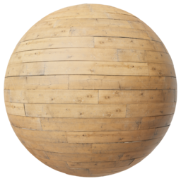
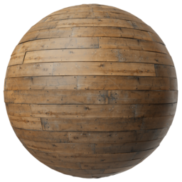
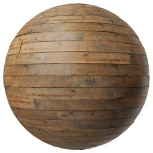
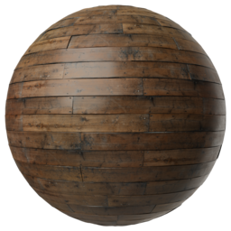
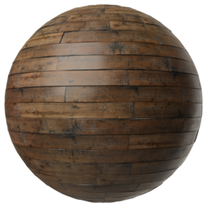
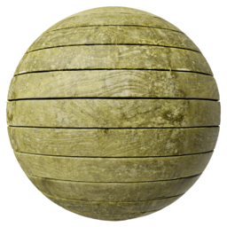
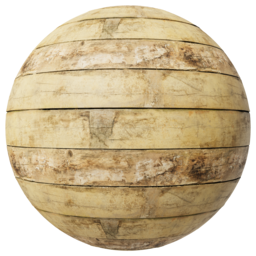
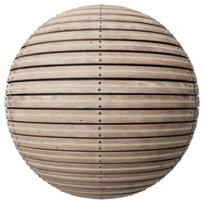

# ambientCG: Planks materials

**9 assets from [ambientCG](https://ambientcg.com), dedicated to the public domain under [CC0](https://docs.ambientcg.com/license/).** Use them in any game, free or paid, and change them however you like; no credit is needed.

PBR materials as 1K and 2K JPG maps (colour, normal GL and DX, roughness, AO, displacement), one folder per resolution. 236.7 MB in all.

This is a copy kept by [zuujis-cc0](https://github.com/zuujis-cc0) so game makers can take single files from GitHub. It is not made by or affiliated with ambientCG: the originals, often in more formats and higher resolutions, are on [ambientcg.com](https://ambientcg.com). If they help you, consider [supporting ambientCG](https://www.patreon.com/ambientCG).

Every file is listed in [MANIFEST.tsv](MANIFEST.tsv) with its size and SHA-256. More free assets: [the Zuujis collection](https://github.com/zuujis-cc0/free-game-assets#readme).

| | | | |
| :-: | :-: | :-: | :-: |
|  <b><a href="Planks035A">Planks 035 A</a></b> by ambientCG · <a href="https://ambientcg.com/a/Planks035A">source</a> |  <b><a href="Planks035B">Planks 035 B</a></b> by ambientCG · <a href="https://ambientcg.com/a/Planks035B">source</a> |  <b><a href="Planks036A">Planks 036 A</a></b> by ambientCG · <a href="https://ambientcg.com/a/Planks036A">source</a> |  <b><a href="Planks036B">Planks 036 B</a></b> by ambientCG · <a href="https://ambientcg.com/a/Planks036B">source</a> |
|  <b><a href="Planks037A">Planks 037 A</a></b> by ambientCG · <a href="https://ambientcg.com/a/Planks037A">source</a> |  <b><a href="Planks037B">Planks 037 B</a></b> by ambientCG · <a href="https://ambientcg.com/a/Planks037B">source</a> |  <b><a href="Planks038">Planks 038</a></b> by ambientCG · <a href="https://ambientcg.com/a/Planks038">source</a> |  <b><a href="Planks039">Planks 039</a></b> by ambientCG · <a href="https://ambientcg.com/a/Planks039">source</a> |
|  <b><a href="Planks040">Planks 040</a></b> by ambientCG · <a href="https://ambientcg.com/a/Planks040">source</a> |  |  |  |

---

Kept up to date by this repository's own [update workflow](.github/workflows/update.yml), with code and plan from [cc0-mirror](https://github.com/zuujis-cc0/cc0-mirror). Something wrong? [Open an issue there](https://github.com/zuujis-cc0/cc0-mirror/issues/new) or use the [private report form](https://games.zuujis.com/report).
